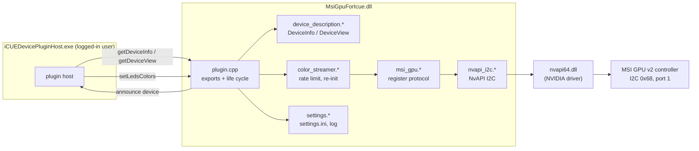

# Architecture

msi-gpu-for-icue is a single DLL, `MsiGpuForIcue.dll`, that iCUE 5 loads from
`<iCUE>\plugins\MsiGpuForIcue`. It has no runtime dependencies besides Windows
and the NVIDIA driver.

## Modules

| File | Responsibility |
| --- | --- |
| `src/plugin.cpp` | The four `CorsairPlugin*` exports and the function table. Owns the worker thread: detect the card, announce it, run the streamer until `unsubscribe`. |
| `src/abi_guard.h` | Exception barrier around everything iCUE calls. |
| `src/cue_plugin_abi.h` | The reverse-engineered iCUE device-plugin structures, see [icue-plugin-abi.md](icue-plugin-abi.md). |
| `src/device_description.*` | Builds and frees `DeviceInfo` / `DeviceView`, the stable device id, the pictures and light bar of each card style (`kArt`), image hashes, and the averaging of LED colours. Pure functions without global state. |
| `src/card_style.h` | `CardStyle`: the design families that share one set of pictures in `images/<style>/`. |
| `src/color_streamer.*` | Turns the stream of colours from iCUE into I2C frames: rate limit, de-duplication, re-init after failures and after sleep. Depends only on the `LightDevice` and `Clock` interfaces. |
| `src/light_device.h` | `Rgb` and the `LightDevice` interface. |
| `src/msi_gpu.*` | `LightDevice` implementation for the MSI GPU v2 controller and the table of supported cards, see [protocol.md](protocol.md). |
| `src/nvapi_i2c.*` | Loads `nvapi64.dll`, enumerates GPUs and performs SMBus-style byte reads and writes. |
| `src/settings.*` | `settings.ini` parsing and the log file. |
| `src/version.*` | Version number (maintained by release-please) and the DLL version resource. |

## Threads

- **iCUE's threads** call the exported functions. `setLedsColors` only
  averages the colours and hands the result to `ColorStreamer::Submit()`,
  which never blocks on I/O.
- **The worker thread** (one per subscription) detects the card and then runs
  `ColorStreamer::Run()`. It is the only thread that talks to the card.
- `PluginState` has three mutexes, always taken in this order:
  1. `lifecycle` serialises `subscribe` / `unsubscribe` / `FreeInstance` and is
     held across joining the worker, so two of them can never interleave;
  2. `announce` is held by the worker while it calls iCUE's callback;
     `unsubscribe` takes it briefly, so no announcement can arrive after
     `unsubscribe` has returned;
  3. `mutex` guards the state itself.

  Below them come the streamer's mutex and NvAPI's. Only `announce` is held
  while calling into iCUE.
- Every function iCUE calls runs inside `Guarded()` (`src/abi_guard.h`), so
  no C++ exception can unwind into the host.

## Life cycle

1. iCUE calls `CorsairPluginGetAPIVersion`, `CorsairPluginGetFeatures` and
   `CorsairPluginGetInstance`.
2. `subscribe(context, callback)` starts the worker. It runs
   `MsiGpu::Detect()` until a supported card is found, retrying after 2 s,
   4 s, … up to every 60 s (NvAPI may not be ready right after login).
   Identical results are logged once. The card is announced with
   `callback(context, "MSIGPU_…", 1)`.
3. iCUE asks for `getDeviceInfo` and `getDeviceView`, then calls
   `setLedsColors` for every lighting frame.
4. `unsubscribe` interrupts detection or stops the streamer, joins the worker
   and forgets the device. With `TurnOffOnExit=1` the LEDs are switched off
   first. `CorsairPluginFreeInstance` unsubscribes as well, so the worker is
   always gone before the DLL is unloaded.
5. The plugin state is intentionally never destroyed: if the host exits
   without unsubscribing, the destructor of a running `std::thread` would
   call `std::terminate()`.

## Streaming rules

`ColorStreamer` keeps only the newest colour and writes it

- at most once per `FrameMs` (default 33 ms),
- only if it differs from what the card already shows,
- after the rate-limit pause it re-reads the newest colour, so the last colour
  of a fade is never dropped (and skips it if that is what the card already
  shows),
- with the full init sequence (`EnterDirect`) on the first frame, after a
  failed write and after a loop gap of more than 5 s, which means the PC was
  asleep and the controller may have lost its mode.

Failed writes are retried with exponential backoff (200 ms, 400 ms, … up to
5 s). Only the 1st, 2nd, 4th, 8th, … failure in a row is logged, followed by
`recovered after N failed write(s)`, so a busy bus (for example MSI Center
fighting over the controller) cannot flood the log. `unsubscribe` takes effect
after the current pause, i.e. within one frame or retry delay.

## Testability

Everything that touches hardware or time sits behind a seam:

- `nvi2c::SetLibraryName()` loads `tests/fake_nvapi` instead of the driver. The
  fake records every I2C transfer and decodes `NV_I2C_INFO_V3` at its
  documented byte offsets, so the request layout is checked independently of
  the struct in `nvapi_i2c.cpp`.
- `ColorStreamer` takes a `LightDevice` and a `Clock`; the tests use a fake
  device and a clock that only moves when told to. (`MsiGpu`'s optional
  per-register delay and the worker's detection backoff use real time; the
  tests keep them at a few milliseconds.)
- `SetSettings()` and `SetLogPath()` replace the process settings and the log
  file.
- One test loads the built `MsiGpuForIcue.dll` and checks its export table and
  version resource.

See [development.md](development.md) for how to run the tests and the
coverage gate.
